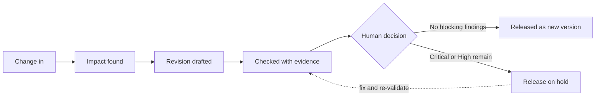

<div align="center">

# 🏷️ LabelGuard AI

### Change-driven, evidence-backed medical device labeling automation

*One change should find its own labels, draft its own revisions, check itself, then wait for a person.*

<br>

[](https://claude.ai/artifact/7B6h2wNXTqh56skPAAj1ru)


**[🚀 Open the demo](https://claude.ai/artifact/7B6h2wNXTqh56skPAAj1ru)** · **[🧭 Take the guided tour](https://claude.ai/artifact/7B6h2wNXTqh56skPAAj1ru)** · **[📐 See the architecture](https://claude.ai/artifact/7B6h2wNXTqh56skPAAj1ru)**

> 🔗 *Example link. Replace it with your final deployed URL (search this file for `claude.ai/artifact`).*

</div>

---

## 👉 Try it in 60 seconds

1. Open the **[live demo](https://claude.ai/artifact/7B6h2wNXTqh56skPAAj1ru)**.
2. Click **Guided tour** in the top bar. It walks through the pitch, then runs the real scenario step by step.
3. Prefer to drive yourself? Click **Autopilot** to run one change end to end, then open **Validation** and **Approvals**.
4. In **Approvals**, press *Approve demo revision* on a held draft. The release gate refuses.

No install, no sign-up, no real data.

---

## 🩺 The problem

A single product change at a global device maker can mean updating:

| 30+ | 20+ | Multiple | Regional |
|:---:|:---:|:---:|:---:|
| labels | languages | packaging levels | regulatory requirements |

*(Teliport Case Study 4, problem context.)*

Today this work runs on spreadsheets, copy and paste between PLM, ERP and labeling tools, manual redlines and repeated reviews. The key risk is a **missed affected label**.

## 💡 Our idea

LabelGuard AI starts from the **change**, not from a blank label.



Every step writes to one audit ledger, so any label element can be traced to product data, a source, a finding and a decision.

## ✨ What is new

AI label writers, rule checkers and artwork comparison already exist, and the case study lists them. We do not claim any one of them as new. The new part is how they connect.

| | |
|---|---|
| **Impact before revision** | Trace the change to affected variants first, then draft. |
| **Evidence with every finding** | Each finding names the rule, the label location, the action and whether a human must confirm. |
| **Risk-aware release gate** | Critical or High findings block release. Qualified humans keep final approval. |
| **One variant graph, one ledger** | Change, source, labels, drafts, findings and decisions live in one record. |

## 🧩 What is inside the prototype

| Module | What you can do |
|---|---|
| **Control center** | See products, variants, open findings and the seeded errors to look for. |
| **Change impact** | Type a change in plain words or use a preset. Get exact and possible matches with the reason for each, plus a list of variants that were *not* flagged. |
| **Label studio** | Compare approved and proposed labels with a word-level redline. Edit text. Apply assisted fixes. |
| **Validation** | Rules R1–R7 with severity, rule, location and recommended action. Mock artwork comparison. |
| **Approvals** | Approve, reject or request changes. The gate refuses while blocking findings remain. |
| **Traceability** | Lineage from change to new version, plus where each label element comes from. |
| **Analytics** | Seeded-error detection and affected-label identification on a test set. |
| **Architecture** | Clickable diagram with a *Play the change flow* animation. |
| **Problem coverage** | All 10 required points and all 10 suggested approaches, each with an honest status. |

## 🎬 Demo scenario

Fictional product **MD-101** (RapidDx Analyzer Cartridge). The storage statement changes from **2–8°C** to **2–10°C** under a fictional change order.

- Nine label variants across US, EU and JP are searched.
- 6 exact matches and 1 possible match (the French carton, whose wording differs) are found.
- Four errors are seeded on purpose and caught: missing manufacturer (German), wrong REF (French), missing IFU symbol (Japanese), hyphen format variant (EU pouch).
- Clean drafts are approved as new versions. The German and French cartons stay on hold until fixed.

## ✅ What is real, what is simulated

We label everything so nothing is overstated.

| Status | Parts |
|---|---|
| 🟢 **Built** | Change impact matching, draft substitution, word-level redline, rules R1–R6, assisted fixes, release gate, audit log, lineage |
| 🔵 **Partly built** | Data store (browser storage), translation check (numbers only), analytics |
| 🟠 **Simulated** | AI drafting with an LLM, artwork comparison (R7), all timing figures |
| ⚪ **Roadmap** | Regulatory watch, glossary and translation memory, PLM and ERP connectors, predictive analytics |

> ⚠️ **Not regulatory software.** Rules are demo rules over fictional data. They are not regulatory requirements and do not certify any label. Every regulatory interpretation, translation, symbol, UDI and release decision needs qualified human review.

## 🛠️ Feasibility

No new AI model is needed. The plan uses common tools:

| Layer | Existing technology |
|---|---|
| Frontend | React, Vite, Tailwind CSS |
| Data | PostgreSQL, object storage |
| Drafting | An LLM API with retrieval over the controlled data store |
| Document reading | pdf.js, Tesseract OCR |
| Artwork comparison | OpenCV or pixel diff, barcode decoder |
| Validation | Deterministic rules engine maintained by Regulatory Affairs |
| Workflow and audit | State machine, append-only log |

## 🗺️ Roadmap

- [x] **Now:** interactive Round 1 prototype on fictional data
- [ ] **Next:** React app and API, PostgreSQL store, real PDF text extraction, LLM drafting grounded in the store, role-based login
- [ ] **Then:** PLM and ERP connectors, OCR, image diff and barcode decode, translation memory checks
- [ ] **Later:** regulatory watch mapped to variants, predictive risk score, agent roles per engine with human sign-off kept

## 📏 How we will measure

Measured on a labelled test set, never claimed in advance.

- **Seeded-error detection:** errors caught ÷ errors seeded
- **Affected-label identification:** recall and precision against known ground truth
- **Review time per change:** baseline vs assisted on the same test set
- **Traceability completeness:** findings with a rule and a source ÷ all findings

## 📚 References

Listed in the case study. Listing a reference does not mean the prototype implements it.

1. [FDA: General Device Labeling Requirements](https://www.fda.gov/medical-devices/device-labeling/general-device-labeling-requirements)
2. [EU MDR: Regulation (EU) 2017/745](https://eur-lex.europa.eu/legal-content/EN/TXT/?uri=CELEX%3A02017R0745-20230320)
3. [ISO 20417:2026](https://www.iso.org/standard/88714.html)
4. [ISO 15223-1: Symbols](https://www.iso.org/standard/77326.html)
5. [IMDRF: Principles of Labelling](https://www.imdrf.org/documents/principles-labelling-medical-devices-and-ivd-medical-devices)
6. [European Commission: UDI](https://health.ec.europa.eu/medical-devices-topics-interest/unique-device-identifier-udi_en)
7. [FDA: UDI Form and Content](https://www.fda.gov/regulatory-information/search-fda-guidance-documents/unique-device-identification-system-form-and-content-unique-device-identifier-udi)

## 💻 Run it locally

The prototype is a single self-contained HTML file with no build step.

```bash
# open index.html in any modern browser, or serve it:
python3 -m http.server 8000
# then visit http://localhost:8000
```

Demo state is saved in your browser. Use **Reset demo data** in the top bar to start over.

## 👥 Team

| | |
|---|---|
| **Team name** | _your team name_ |
| **Institution** | _your institution_ |
| **Members** | _names_ |

---

<div align="center">

Built for **Teliport Season 4 · Case Study 4** · End-to-End Labeling Automation Management for Medical Devices

<sub>All products, labels and change orders in the demo are fictional.</sub>

</div>
